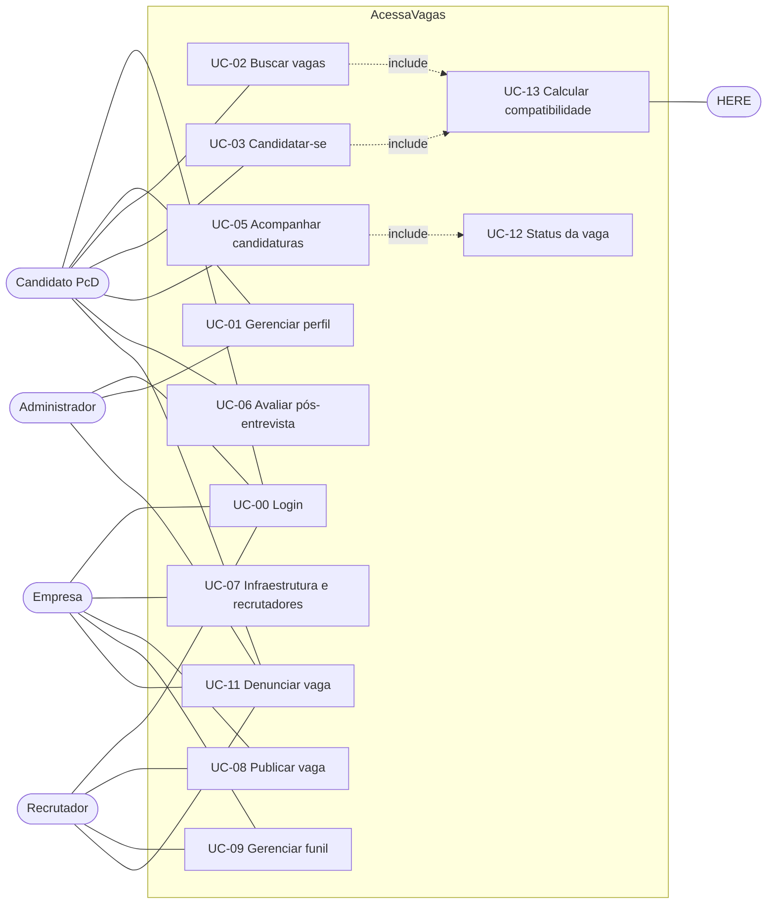

# Visão Geral dos Casos de Uso

## Atores

| Ator | Quem é | Como entra |
|---|---|---|
| Candidato PcD | Pessoa com deficiência procurando vaga | Cria a própria conta; entra com e-mail ou CPF |
| Empresa | Conta organizacional, com CNPJ e e-mail corporativo confirmado | Cria a própria conta; entra com e-mail |
| Recrutador | Pessoa convidada pela Empresa, com vínculo ativo | Aceita o convite da Empresa; entra com e-mail |
| Administrador | Equipe da plataforma | Conta criada pela equipe; entra por `/admin/login` |
| Serviço de trajeto (HERE) | Sistema externo | Ator secundário do UC-13 |
| Fonte de vagas externas (Adzuna) | Sistema externo | Ator secundário do UC-14 (não implementado) |

Empresa e Recrutador fazem as mesmas operações de vagas e funil, sempre sobre as vagas da própria Empresa. Só a Empresa convida recrutadores e mantém a infraestrutura. Não existe ator separado de "Gestor de Seleção".

## Casos de uso

| UC | Nome | Atores | Situação |
|---|---|---|---|
| UC-00 | Login (entrada, cadastro e recuperação de senha) | Todos | Implementado (SPEC-001) |
| UC-01 | Gerenciar perfil (e catálogo de necessidades) | Candidato, Administrador | Implementado (SPEC-002) |
| UC-02 | Buscar vagas | Candidato | Implementado (SPEC-008) |
| UC-03 | Candidatar-se a vaga | Candidato | Implementado (SPEC-011) |
| UC-04 | — | — | Número não usado no projeto (a numeração pula do UC-03 para o UC-05) |
| UC-05 | Acompanhar candidaturas | Candidato | Implementado (SPEC-012, SPEC-016) |
| UC-06 | Avaliar pós-entrevista | Candidato | Implementado (SPEC-018, SPEC-021) |
| UC-07 | Cadastrar infraestrutura e recrutadores | Empresa | Implementado (SPEC-001, SPEC-004) |
| UC-08 | Publicar vaga | Empresa, Recrutador | Implementado (SPEC-005, SPEC-009) |
| UC-09 | Gerenciar funil de seleção | Empresa, Recrutador | Implementado (SPEC-013, SPEC-018) |
| UC-10 | Validar requisitos da seleção | Empresa, Recrutador | Fora do escopo desta versão |
| UC-11 | Denunciar vaga incompatível | Candidato, Administrador, Empresa | Implementado (SPEC-019, SPEC-020) |
| UC-12 | Status da vaga | Candidato | Implementado (SPEC-009, SPEC-010) |
| UC-13 | Calcular compatibilidade | Candidato, HERE | Implementado (SPEC-007) |
| UC-14 | Coletar e ingerir vagas externas | Sistema, Adzuna, Administrador | Não implementado na `main` (SPEC-006 em revisão no PR #68) |

Os avisos (na plataforma e por e-mail, SPEC-017) acompanham UC-03, UC-05, UC-08, UC-09 e UC-11 e não têm caso de uso próprio.

## Fluxo principal do sistema

1. A Empresa cria a conta, confirma o e-mail, preenche a infraestrutura e convida recrutadores (UC-00, UC-07).
2. A Empresa ou um Recrutador cadastra e publica vagas (UC-08).
3. O candidato cria a conta, aceita os termos e completa o perfil, dando o consentimento para os dados de acessibilidade (UC-00, UC-01).
4. O candidato busca vagas; o sistema calcula a compatibilidade e oculta as vagas com barreira crítica (UC-02, UC-13).
5. O candidato se candidata e acompanha a candidatura (UC-03, UC-05, UC-12).
6. A Empresa ou o Recrutador move a candidatura pelo funil e agenda entrevistas; o candidato é avisado (UC-09).
7. Depois de uma entrevista concluída, o candidato pode avaliar a Empresa e, se for o caso, denunciar a vaga (UC-06, UC-11).
8. O Administrador analisa e decide as denúncias (UC-11) e mantém o catálogo de necessidades de acessibilidade (UC-01).

## Diagrama

UC-10 e UC-14 ficam fora do diagrama porque não estão implementados nesta versão.
