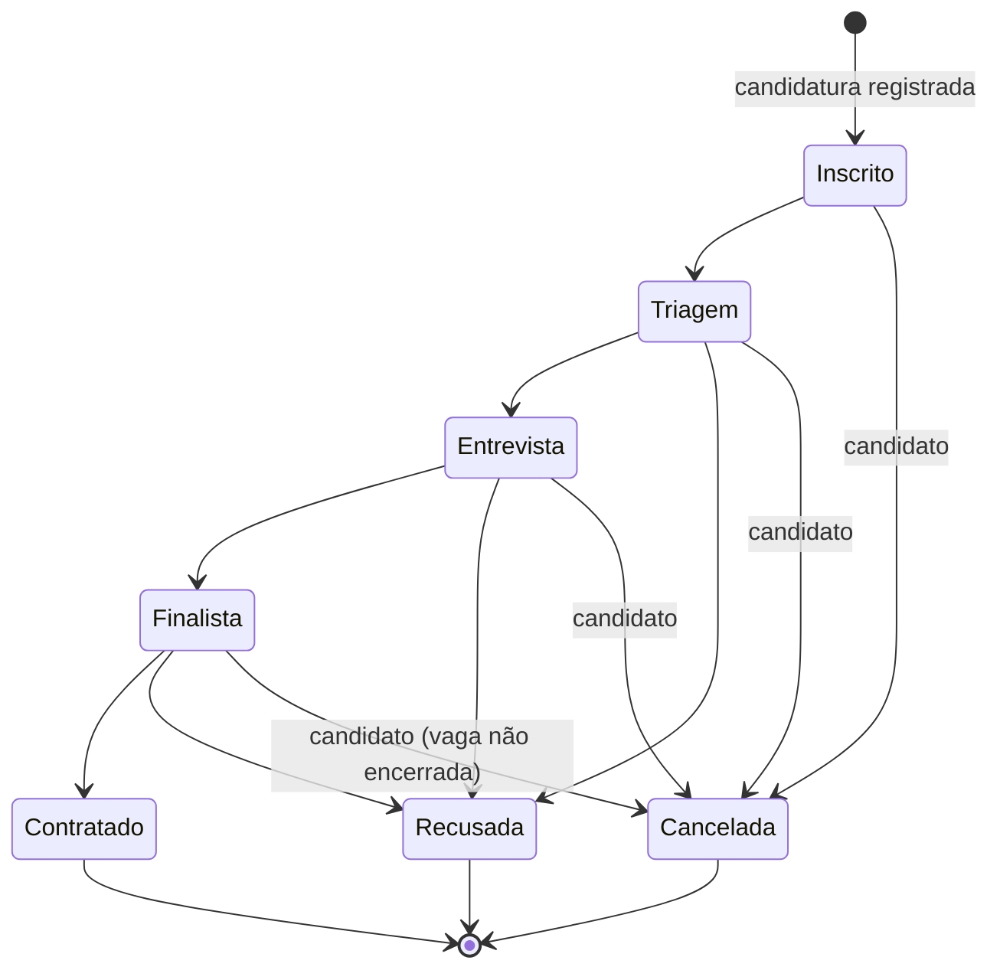

# Estado da trilha de vagas compatíveis

## Objetivo

Descrever o fluxo de processamento e apresentação das vagas compatíveis, complementando UC-02 e UC-13.

## Pré-condições

- Candidato autenticado. O perfil pode estar incompleto: o que faltar aparece como "não informado".
- Existem vagas publicadas por empresas na plataforma. Vagas externas não entram nesta versão (SPEC-006 em revisão no PR #68).

## Fluxo principal

1. O sistema recupera do perfil as necessidades (e quais são indispensáveis), o perfil técnico, a localização, o meio de transporte e as modalidades aceitas.
2. Consulta as vagas abertas e dentro do prazo de inscrição (estado Aberta, ver "Estados da vaga").
3. Aplica a busca por texto e os filtros escolhidos (UC-02).
4. Para cada vaga, verifica a acessibilidade declarada e elimina as que têm barreira crítica para o candidato.
5. Para as demais, calcula 50% acessibilidade, 30% perfil técnico e 20% modalidade e deslocamento, redistribuindo os pesos das dimensões que não se aplicam (UC-13).
6. Apresenta os resultados (até 100, 20 por página) com o score ou "dados insuficientes" e os principais fatores.
7. O candidato pode abrir a vaga e se candidatar (UC-03).

## Fluxos alternativos

### A1 — Vaga externa (não implementado)
Previsto na SPEC-006: a vaga seria identificada, estruturada e validada antes da análise, e dados de LLM só seriam usados após validação. Nesta versão a busca considera apenas vagas próprias.

### A2 — Barreira incompatível
A vaga é considerada incompatível: não aparece na busca e não aceita candidatura. O sistema informa quantas vagas foram ocultadas por esse motivo.

### A3 — Acessibilidade não informada
A ausência de informação é tratada como "não informado", sem assumir compatibilidade. O resultado fica "dados insuficientes", sem score final, e a candidatura continua permitida.

### A4 — Nenhuma vaga compatível
O sistema informa o resultado e permite nova busca com outros filtros.

## Estados da vaga

| Estado | Visível para o candidato | Aceita candidatura | Rótulo para o candidato |
|---|---|---|---|
| Rascunho | Não | Não | — |
| Aberta (no prazo) | Sim | Sim | Aberta |
| Aberta (prazo vencido) | Só no detalhe e nas candidaturas | Não | Indisponível |
| Pausada | Só no detalhe e nas candidaturas | Não | Indisponível |
| Encerrada | Só no detalhe e nas candidaturas | Não | Encerrada |

Transições (feitas pela Empresa ou pelo Recrutador, UC-08): Rascunho → Aberta (publicar); Aberta → Pausada (pausar); Pausada → Aberta (reabrir); Aberta ou Pausada → Encerrada (encerrar, definitivo). Não existe estado "bloqueada".

## Regras de negócio relacionadas

- RB-01, RB-02, RB-03, RB-04, RB-05, RB-06, RB-13, RB-16, RB-30, RB-42.
- RB-10, RB-11, RB-17, RB-18 (vagas externas, opcionais).

## Requisitos relacionados

- RF-06, RF-07, RF-08, RF-09, RF-10, RF-18, RF-24, RF-25.
- RF-05 (opcional, SPEC-006).

## Estados do funil de seleção

Os estados padronizados do funil de seleção são:

1. **Inscrito** — candidatura registrada para a vaga.
2. **Triagem** — candidatura em avaliação inicial.
3. **Entrevista** — candidato em etapa de entrevista.
4. **Finalista** — candidato selecionado para a etapa final do processo.
5. **Contratado** — decisão final de contratação registrada.
6. **Recusada** — candidatura encerrada sem contratação
7. **Cancelada** — candidatura encerrada por solicitação do candidato após confirmação; estado terminal separado das transições do funil de recrutamento.

### Transições válidas

- Inscrito → Triagem.
- Inscrito → Cancelada (por solicitação do candidato, após confirmação).
- Triagem → Entrevista.
- Triagem → Cancelada (por solicitação do candidato, após confirmação).
- Triagem → Recusada.
- Entrevista → Finalista.
- Entrevista → Recusada.
- Entrevista → Cancelada (por solicitação do candidato, após confirmação).
- Finalista → Contratado.
- Finalista → Recusada.
- Finalista → Cancelada (por solicitação do candidato, após confirmação).

O sistema impede transições fora desse conjunto. Quem move o funil é a Empresa ou o Recrutador vinculado (UC-09); só o candidato cancela (UC-05). Se a vaga estiver encerrada, o candidato só pode cancelar até Entrevista.

### Diagrama de estados da candidatura

[Imagem do diagrama](estados-trilha.png)

### Condições formais para avanço

Antes de alterar a etapa da candidatura, o sistema deve validar:

1. **Autorização:** a Empresa ou o Recrutador com vínculo ativo está autenticado e gerencia a vaga e suas candidaturas.
2. **Transição permitida:** a mudança solicitada pertence ao conjunto de transições válidas listado acima, conforme RB-39.
3. **Pendências impeditivas:** não há pendências conhecidas que impeçam o avanço. Nenhum tipo de pendência foi definido até agora (OPEN-092), então hoje esta verificação não barra nenhuma mudança.
4. **Etapa atual:** a etapa ainda é a que o ator viu; se outra pessoa mudou antes, a mudança é recusada.
5. **Rastreabilidade:** quando a transição for válida, a etapa é atualizada e a movimentação é registrada conforme RB-27, RB-37 e RB-41. O histórico registra etapa anterior e resultante, data e hora, ator responsável e tipo de movimentação/decisão; uma observação interna opcional pode acompanhar a mudança. O candidato é avisado de cada mudança.

O banco de dados não permite alterar nem apagar eventos do histórico. Não são permitidas reversões fora das transições previstas na RB-39; alterações futuras do fluxo dependem de aprovação explícita do projeto e atualização dos artefatos afetados. A Empresa e o Recrutador acessam somente os dados necessários à candidatura e à vaga sob sua responsabilidade; informações de acessibilidade são limitadas à necessidade do processo, sem acesso a laudos médicos ou a candidaturas de outras Empresas. A etapa não amplia automaticamente as permissões.

Não são definidos critérios específicos adicionais por etapa, notas mínimas ou documentos obrigatórios sem decisão explícita do projeto.

## Regras relacionadas ao funil

- RB-38 — Estados do funil.
- RB-39 — Transições válidas do funil.
