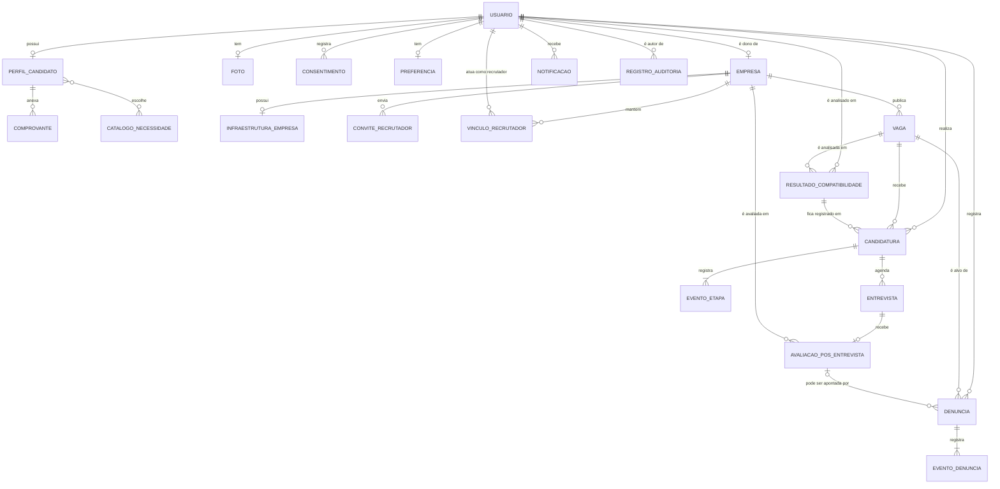

# Modelo Conceitual

Este modelo descreve as entidades de negócio como estão implementadas em `prisma/schema.prisma`. Entre parênteses, o nome do modelo no código. Atributos técnicos (datas de criação e atualização, chaves internas) foram omitidos quando não acrescentam significado.

## Entidades e atributos

### USUARIO (`User`)

Conta de acesso de qualquer perfil.

- `id` (PK)
- `email` (único)
- `cpf` (único; só candidato)
- `nome_completo`
- `hash_senha` (Argon2id)
- `perfil`: CANDIDATE, COMPANY, RECRUITER ou ADMIN
- `ativo` e `aguardando_ativacao` (recrutador convidado que ainda não aceitou)
- `bloqueado_ate` e contagem de falhas de login (bloqueio de 15 min após 10 falhas)

O candidato entra com e-mail ou CPF; os demais perfis, com e-mail. Recrutador e Administrador não são entidades separadas: são perfis de USUARIO.

### PERFIL_CANDIDATO (`CandidateProfile`)

Dados profissionais e de acessibilidade do candidato (1:1 com USUARIO de perfil CANDIDATE).

- `id` (PK), `id_usuario` (FK, único)
- `escolaridade`, `competencias`, `idiomas`, `experiencias`, `cursos`, `certificacoes`, `links_profissionais` (listas)
- `preferencias_trabalho`: modalidades aceitas, cidade, estado, endereço e meio de transporte
- `declaracao_acessibilidade`: NOT_INFORMED (não informado), NO_NEEDS_DECLARED (declarou não ter) ou NEEDS_DECLARED
- `necessidades_catalogo` (códigos do CATALOGO_NECESSIDADE), `necessidades_obrigatorias` (códigos marcados como indispensáveis) e `necessidades_texto_livre`
- `recursos_indispensaveis`

Os dados de acessibilidade só existem enquanto houver consentimento válido (CONSENTIMENTO).

### COMPROVANTE (`CandidateProfileDocument` + `CandidateDocumentContent`)

- `id` (PK), `id_perfil` (FK)
- `categoria`: curso ou certificação
- `nome_exibido`, `nome_original`, `tipo`, `tamanho` (até 4 MB)
- `conteudo` (bytes, guardados no banco em tabela separada)

### CATALOGO_NECESSIDADE (`AccessibilityNeedOption`)

Catálogo oficial mantido pelo Administrador (16 códigos iniciais, OPEN-008).

- `codigo` (PK), `nome`, `descricao`
- `grupo`: arquitetônico, comunicação ou tecnológico
- `obrigatoria`, `ativa`

### FOTO (`UserPhoto`)

- `id_usuario` (PK, FK), `conteudo` (bytes, até 1 MB), `tipo`

Só candidato e recrutador têm foto (RB-48).

### CONSENTIMENTO (`ConsentRecord`)

Registro de cada aceite ou retirada; o banco não permite alterá-lo.

- `id` (PK), `id_usuario` (FK)
- `tipo`: TERMS_AND_PRIVACY (Termos e Política de Privacidade) ou ACCESSIBILITY_DATA (dados de acessibilidade)
- `versao` dos documentos legais, `concedido` (sim ou não), `data`

### PREFERENCIA (`UserPreference`)

- `id_usuario` (PK, FK)
- `preferencias`: alto contraste (automático, ligado ou desligado) e avisos por e-mail (ligado ou desligado)

### EMPRESA (`Company`)

- `id` (PK)
- `razao_social`, `nome_fantasia`
- `cnpj` (único, 14 dígitos)
- `email_contato`, `email_confirmado_em`
- `id_usuario_conta` (FK, único): a conta COMPANY dona da Empresa

### INFRAESTRUTURA_EMPRESA (`CompanyInfrastructure`)

- `id` (PK), `id_empresa` (FK, único)
- `respostas`: para cada um dos seis itens (rampas, elevadores, banheiros adaptados, sinalização, leitores de tela, políticas inclusivas), estado Presente, Ausente ou Não informado e observação de até 300 caracteres

### VINCULO_RECRUTADOR (`RecruiterLink`)

- `id` (PK), `id_empresa` (FK), `id_recrutador` (FK USUARIO)
- `ativo`, `inicio`, `fim`

Um recrutador tem no máximo um vínculo ativo (garantido pelo banco).

### CONVITE_RECRUTADOR (`RecruiterInvitation`)

- `id` (PK), `id_empresa` (FK), `id_destinatario` (FK USUARIO, opcional), `id_remetente` (FK USUARIO)
- `nome_destinatario`, `email_destinatario`
- `status`: pendente, recusado, expirado, cancelado ou aceito
- `expira_em` (7 dias), `respondido_em`

### VAGA (`Job`)

- `id` (PK), `id_empresa` (FK), `id_criador` (FK USUARIO)
- `status`: rascunho, aberta, pausada ou encerrada
- `origem`: própria (única origem implementada; vagas externas dependem da SPEC-006)
- `titulo`, `descricao`, `requisitos`, `area_profissional`
- `modalidade`: presencial, híbrido ou remoto
- `cidade`, `estado`, `endereco`
- `prazo_inscricao`, `salario_minimo`, `salario_maximo`
- `acessibilidade`: estado declarado de cada um dos seis itens (é a trava crítica da vaga)
- `criterios_tecnicos`: competências, experiências, escolaridade mínima e idiomas
- `publicada_em`, `encerrada_em`

### RESULTADO_COMPATIBILIDADE (`CompatibilityResult`)

Cada análise registrada (SPEC-007).

- `id` (PK), `id_candidato` (FK USUARIO), `id_vaga` (FK)
- `status`: completo, dados insuficientes ou incompatível
- `score` (0 a 100, vazio quando não completo)
- `versao_regras`, `data_execucao`
- `retrato_entradas` e `resultado` (dimensões, fatores, pendências)
- `hash_entradas` (para reaproveitar o resultado enquanto nada mudar)

### CANDIDATURA (`Application`)

- `id` (PK), `id_candidato` (FK USUARIO), `id_vaga` (FK), `id_resultado_compatibilidade` (FK)
- `data_inscricao` (gerada pelo sistema)
- `etapa`: Inscrito, Triagem, Entrevista, Finalista, Contratado, Recusada ou Cancelada
- `score` (pode ser vazio quando faltaram dados)
- `oculta_pelo_candidato_em`

Só pode haver uma candidatura ativa por candidato e vaga (índice único parcial no banco).

### EVENTO_ETAPA (`ApplicationStageEvent`)

Histórico do funil; o banco não permite alterar nem apagar eventos.

- `id` (PK), `id_candidatura` (FK)
- `etapa_anterior`, `etapa_nova`
- `tipo`: registro, avanço, recusa, contratação ou cancelamento
- `id_autor` (FK USUARIO), `observacao`, `data`

### ENTREVISTA (`Interview`)

- `id` (PK), `id_candidatura` (FK), `id_criador` (FK USUARIO)
- `data_hora`, `modalidade` (presencial ou on-line), `local_ou_link`, `recursos_acessibilidade`
- `status`: agendada, concluída ou cancelada; `concluida_em`, `cancelada_em`

### AVALIACAO_POS_ENTREVISTA (`InterviewEvaluation`)

- `id` (PK), `id_entrevista` (FK, única), `id_candidatura`, `id_candidato`, `id_empresa` (FK)
- `nota_acessibilidade` e `nota_postura_inclusiva` (1 a 5)
- `comentario` (opcional), `enviada_em`
- `anonimizada_em`: após 1 ano, os vínculos com entrevista, candidatura e candidato e o comentário são apagados; ficam só as notas, a Empresa e o ano do envio

Não há opção "anônima" no envio: a nota pública já é sempre agregada e sem identificação.

### DENUNCIA (`Report`)

- `id` (PK), `id_denunciante` (FK USUARIO), `id_vaga` (FK), `id_empresa` (FK, vem da vaga), `id_avaliacao` (FK, opcional)
- `categoria`: possível incompatibilidade de acessibilidade ou possível falsa inclusão
- `descricao`, `evidencia`, `risco_informado`, `alta_prioridade`
- `status`: recebida, em análise, aguardando informações ou concluída
- `prazo` (5 dias úteis), `motivo_prorrogacao`
- `pedido_empresa`, `resposta_empresa`
- `decisao`: procedente, parcialmente procedente, improcedente ou inconclusiva; `resumo_denunciante`, `justificativa`, `medidas`, `id_decisor`

### EVENTO_DENUNCIA (`ReportEvent`)

Histórico da moderação, que o banco não permite alterar nem apagar: `tipo`, `status_anterior`, `status_novo`, `id_autor`, `nota`, `data`.

### NOTIFICACAO (`Notification`)

- `id` (PK), `id_destinatario` (FK USUARIO), `id_candidatura` e `id_vaga` (opcionais)
- `tipo`: candidatura registrada, mudança de etapa, cancelamento, vaga encerrada, entrevista agendada/alterada/cancelada, andamento, pedido de informação e conclusão de denúncia
- `conteudo`, `lida_em`
- envio por e-mail: `status` (pendente, enviando, enviado, falhou, não enviado por preferência), `tentativas` (até 5), `proxima_tentativa`

### REGISTRO_AUDITORIA (`AuditEvent`)

- `id` (PK), `id_autor` (FK USUARIO, opcional)
- `tipo_evento`, `tipo_objeto`, `id_objeto`, `detalhes`, `data`
- `reter`: impede o apagamento após 1 ano quando houver obrigação de guarda

## Relações entre entidades

| Origem | Relação | Destino | Cardinalidade |
|---|---|---|---|
| USUARIO (candidato) | possui | PERFIL_CANDIDATO | 1 : 0..1 |
| PERFIL_CANDIDATO | anexa | COMPROVANTE | 1 : 0..N |
| PERFIL_CANDIDATO | escolhe opções de | CATALOGO_NECESSIDADE | N : N (por código) |
| USUARIO | tem | FOTO | 1 : 0..1 |
| USUARIO | registra | CONSENTIMENTO | 1 : 0..N |
| USUARIO | tem | PREFERENCIA | 1 : 0..1 |
| USUARIO (empresa) | é dono de | EMPRESA | 1 : 0..1 |
| EMPRESA | possui | INFRAESTRUTURA_EMPRESA | 1 : 0..1 |
| EMPRESA | envia | CONVITE_RECRUTADOR | 1 : 0..N |
| EMPRESA | mantém | VINCULO_RECRUTADOR com USUARIO (recrutador) | 1 : 0..N (no máximo um ativo por recrutador) |
| EMPRESA | publica | VAGA | 1 : 0..N |
| USUARIO (empresa ou recrutador) | cria | VAGA | 1 : 0..N |
| USUARIO (candidato) + VAGA | geram | RESULTADO_COMPATIBILIDADE | N : N |
| USUARIO (candidato) | realiza | CANDIDATURA | 1 : 0..N |
| VAGA | recebe | CANDIDATURA | 1 : 0..N |
| CANDIDATURA | guarda | RESULTADO_COMPATIBILIDADE do momento | N : 1 |
| CANDIDATURA | registra | EVENTO_ETAPA | 1 : 1..N |
| CANDIDATURA | agenda | ENTREVISTA | 1 : 0..N (no máximo uma agendada por vez) |
| ENTREVISTA | recebe | AVALIACAO_POS_ENTREVISTA | 1 : 0..1 |
| EMPRESA | é avaliada em | AVALIACAO_POS_ENTREVISTA | 1 : 0..N |
| USUARIO (candidato) | registra | DENUNCIA sobre VAGA | 1 : 0..N |
| DENUNCIA | pode apontar | AVALIACAO_POS_ENTREVISTA | N : 0..1 |
| DENUNCIA | registra | EVENTO_DENUNCIA | 1 : 1..N |
| USUARIO (administrador) | decide | DENUNCIA | 1 : 0..N |
| USUARIO | recebe | NOTIFICACAO | 1 : 0..N |
| USUARIO | é autor de | REGISTRO_AUDITORIA | 1 : 0..N |

## Diagrama

[Imagem do diagrama](ModeloConceitual.png)

## Tabelas de apoio técnico (fora do modelo conceitual)

Existem no banco, mas não representam conceitos do negócio:

- `Session`: sessões de login (guardadas por hash).
- `PasswordResetToken`, `CompanyEmailVerificationToken`: links de recuperação de senha e de confirmação de e-mail (por hash, uso único).
- `LoginAttempt`, `LoginBlock`, `RecoveryAttempt`, `RecoveryBlock`: limites contra tentativas repetidas.
- `HereUsage`, `TravelTimeCache`: controle de cota e cache do cálculo de trajeto.

## Mudanças em relação ao modelo inicial

- VETOR_ACESSIBILIDADE_CANDIDATO passou a ser parte do PERFIL_CANDIDATO, com as necessidades escolhidas do CATALOGO_NECESSIDADE.
- TRAVA_CRITICA_VAGA passou a ser o campo `acessibilidade` da VAGA (estado dos seis itens).
- ADMINISTRADOR e RECRUTADOR são perfis de USUARIO, não entidades próprias.
- A avaliação não tem campo `is_anonima`; a denúncia se liga à vaga (e só opcionalmente à avaliação).
- O score da candidatura pode ser vazio (decisão de 31/10/2026).
- Entraram COMPROVANTE, FOTO, CONSENTIMENTO, PREFERENCIA, CONVITE_RECRUTADOR, VINCULO_RECRUTADOR, RESULTADO_COMPATIBILIDADE, EVENTO_ETAPA, EVENTO_DENUNCIA, NOTIFICACAO e REGISTRO_AUDITORIA.
- O Administrador não altera o status das vagas; isso é da Empresa e do Recrutador.
